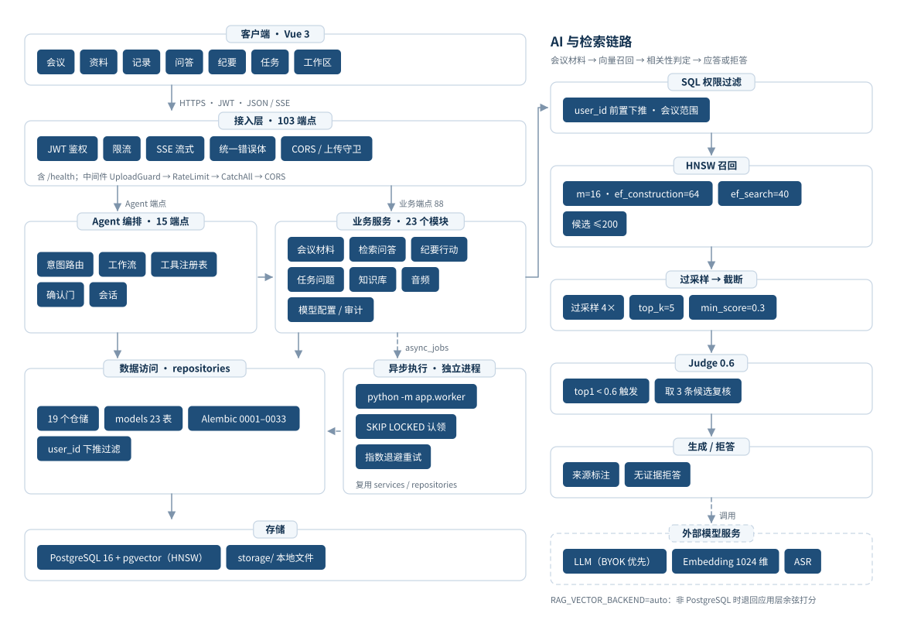

# OpenMIND · AI 会议个人助理

> 把一场会议从「建会」推到「行动项被跟进」——资料可检索、结论有出处、写操作必须经你确认。

[](https://github.com/WiWimin/OpenMIND/actions/workflows/ci.yml)
[](LICENSE)
[](backend/requirements.txt)
[](frontend/package.json)
[](docs/database.md)


---

## 1. 这是什么

OpenMIND 是面向**个人参会者**的 AI 会议助理。它不替代会议软件，而是在会前把资料读薄、会中把内容记实、会后把结论落成待办——整个过程中，AI 只产出**候选**，写库与状态流转始终由你确认。

**为谁而做**：每天开 2–5 场会、需要自己整理纪要与待办的个人。不做多人实时协作、会议主持、组织权限体系——那是团队协作平台的范畴。

**凭什么不一样**：

- **能查到出处**：回答来自你的资料原文，标注来源；找不到证据就说找不到，不编。
- **不会自作主张**：纪要、行动项、联网检索都要过一次确认门，AI 不能直接改你的数据。
- **数据在你手里**：模型密钥自己带（BYOK，加密存库、永不明文回传），会议文件可双向同步到本地目录。

## 2. 功能一览

| 阶段 | 能力 | 说明 |
| --- | --- | --- |
| **会前** | 会议管理 | 创建 / 编辑 / 归档 / 删除；内置与自定义模板（可由 AI 生成草稿），注入后续生成链路 |
| | 资料导入与索引 | PDF / DOCX / TXT 解析 → 800/120 分块 → 1024 维向量 → HNSW 近邻索引；同用户同内容文件复用分块，零重复 Embedding |
| | 会前速览与准备 | 速览卡（60 秒读完：要谈什么、要决定什么）+ 准备要点与清单 |
| **会中** | 记录 | 手动记录与重点 / 决议 / 疑问标记；音频转写（外部 OpenAI 兼容 ASR 或本地 FunASR） |
| | AI 问答 | SSE 流式输出、来源标注、低分带 LLM Judge 复核；材料与记录全无证据时才联网补救 |
| **会后** | 纪要 | 转写确认后自动产出**草稿**（绝不自动确认）；模板渲染、富文本编辑、DOCX 导出 |
| | 行动项 → 任务 | AI 提取候选 → 你逐条确认 → 转为个人任务并跟进 |
| **贯穿** | Agent 编排 | 意图路由 + 声明式工作流 + 确认门 + 证据门（见 §3） |
| | 本地工作区 | File System Access API 双向同步：三方对账、`client_op_id` 幂等、`expected_version` 乐观锁 |
| | 个人知识库 / 记忆中心 | 知识库独立检索（不与会议内容混检）；个人画像注入 Prompt 且截断 ≤500 字 |
| | 可靠性 | 统一错误体、限流、AI 调用审计与成本估算、异步任务队列 + 独立 worker |

## 3. 核心设计

### 3.1 四条不变量

1. **个人数据隔离**：任何查询都以 `user_id` 下推过滤，跨用户访问返回 404 而非 403。
2. **原文与 AI 结果分离**：AI 产出写入独立字段/表，永不覆盖你输入的原文。
3. **候选与确认分离**：AI 只能提出候选，写库、状态流转、任务创建都由用户显式确认。
4. **密钥不落前端**：模型密钥只存在于服务端环境变量或 Fernet 加密的 BYOK 存储中。

### 3.2 Agent 链路

```text
用户输入
  ↓ 意图路由：显式指令 → 规则命中 → LLM 兜底（3s 超时）→ 页面先验
工作流（声明式 Step / Edge / StepRetry）
  ↓ 工具调用：只包 services 与 ai 层，不直接拼 SQL
确认门（写操作前停下，落 pending_action，等待用户批准）
  ↓
证据门（无相关证据则拒答，而非编造）
  ↓
结果落库：agent_runs 是失败的唯一事实来源（同步 502 / SSE error），不落假消息
```

- **确认门幂等**：条件 UPDATE 抢占 + 部分唯一索引（`run_id WHERE status='pending'`）兜底，并发下只有一个请求生效。
- **多轮上下文**：最近 6 条消息 / ≤3000 字符注入 Prompt；记录上下文按问题词面相关性筛选（bigram 覆盖率 ≥0.3，top5，≤4000 字符）。
- **可控预算**：`AGENT_MAX_STEPS`（默认 20）与 `AGENT_MAX_WALL_SECONDS`（默认 600）硬限制单次运行。

设计细节见 [`docs/agent-framework.md`](docs/agent-framework.md)。

## 4. 系统架构



**依赖方向只能自上而下**，跨层调用一律禁止：

- **前端**不直连数据库、不持有密钥，只调 API 与渲染 SSE；本地目录仅在用户授权后经 File System Access API 访问。
- **接入层**是唯一入口：JWT 鉴权、限流、统一错误体；业务状态由后端裁决，前端改状态字段绕不过规则。
- **编排层**（`app/agent`）只做意图路由、工作流与确认门，工具只包 `services` 与 `ai`，不直接拼 SQL。
- **AI 能力层**（`app/ai`）只产出候选与检索结果，不决定任务创建、完成或撤销。
- **数据访问**统一走 `repositories`，查询一律以 `user_id` 下推过滤。

详见 [`docs/architecture.md`](docs/architecture.md)。

## 5. 快速开始

**前置条件**：Docker Desktop（含 Compose v2）。原生开发另需 Python 3.11+ 与 Node 20+。

```bash
git clone https://github.com/WiWimin/OpenMIND.git
cd OpenMIND

# 1) 环境变量（Windows: copy docker\.env.example docker\.env）
cp docker/.env.example docker/.env

# 2) 启动 db / worker / backend / frontend
docker compose -f docker/compose.dev.yml up -d --build

# 3) 执行数据库迁移
docker compose -f docker/compose.dev.yml exec backend alembic upgrade head

# 4)（可选）重建存量向量索引——改动过 RAG_* 参数时需执行
docker compose -f docker/compose.dev.yml exec backend python scripts/reindex_all.py
```

打开 <http://localhost:5173> 注册账号，然后在「设置 → 模型」填入自己的模型 Key（BYOK）即可开始。

| 服务 | 地址 |
| --- | --- |
| 前端 | <http://localhost:5173> |
| 后端 API / Swagger | <http://localhost:8000/docs> |
| 健康检查 | <http://localhost:8000/health> · <http://localhost:8000/api/v1/health/db> |
| 本地 FunASR（可选） | `docker compose -f docker/compose.dev.yml --profile asr up -d asr` → <http://localhost:10096> |

**原生开发**（数据库仍用容器）：

```bash
docker compose -f docker/compose.dev.yml up -d db

cd backend && python -m venv .venv && .venv\Scripts\activate   # macOS/Linux: source .venv/bin/activate
pip install -r requirements.txt && uvicorn app.main:app --reload

cd frontend && npm install && npm run dev
```

**停止服务**：`docker compose -f docker/compose.dev.yml down`（保留数据卷）。
⚠️ `down -v` 会一并删除命名卷，数据不可恢复。

## 6. 配置

全部变量见 [`docker/.env.example`](docker/.env.example)。复制为 `docker/.env` 使用（已被 `.gitignore` 忽略，禁止提交）。

| 变量 | 作用 | 默认 |
| --- | --- | --- |
| `SECRET_KEY` | JWT 签名密钥，非开发环境必须是 ≥32 位随机值 | `change-me` |
| `DATABASE_URL` | SQLAlchemy 连接串 | 指向 compose 内 `db` |
| `ALLOW_GLOBAL_FALLBACK` | 是否允许未配 BYOK 的用户回退到服务端全局模型 | `false` |
| `LLM_*` / `EMBEDDING_*` | 服务端全局模型配置（仅显式开启回退时生效） | 空 |
| `ASR_API_BASE` / `ASR_MODEL` | 外部 OpenAI 兼容 ASR；本地 FunASR 走 compose `asr` profile | 空 |
| `RAG_CHUNK_SIZE` / `RAG_CHUNK_OVERLAP` | 分块大小与重叠，改动后需重建索引 | `800` / `120` |
| `RAG_TOP_K` / `RAG_MIN_SCORE` | 检索条数与相似度阈值 | `5` / `0.3` |
| `RAG_VECTOR_BACKEND` | 向量后端：`auto`（PG→HNSW / SQLite→应用层）、`pgvector`、`python`（回滚） | `auto` |
| `RAG_JUDGE_ENABLED` / `RAG_JUDGE_MIN_SCORE` | 低分带相关性 Judge 开关与触发阈值 | `true` / `0.6` |
| `AGENT_MAX_STEPS` / `AGENT_MAX_WALL_SECONDS` | 单次 Agent 运行的步数与墙钟上限 | `20` / `600` |
| `AGENT_ENABLED` / `AGENT_INTENT_LLM_ENABLED` | Agent 总开关；是否允许 LLM 兜底判意图 | `true` / `true` |
| `JOB_WORKER_ENABLED` | 使用独立 worker 处理异步任务（关闭时回落进程内任务） | `true` |
| `RATE_LIMIT_ENABLED` / `METRICS_ENABLED` | 进程内限流与 `/api/v1/metrics` 运维指标 | `true` / `true` |
| `WEB_SEARCH_ENABLED` / `WEB_SEARCH_REQUIRE_CONFIRMATION` | 联网补救开关；是否每次先征求同意 | `true` / `true` |
| `VITE_API_BASE_URL` | 前端 axios `baseURL` | `http://localhost:8000/api/v1` |

## 7. 开发与测试

| 目标 | 命令 |
| --- | --- |
| 后端 Lint | `cd backend && ruff check .` |
| 后端测试 | `cd backend && pytest`（745 passed / 5 skipped） |
| 前端类型检查 | `cd frontend && npm run typecheck` |
| 前端 Lint | `cd frontend && npm run lint` |
| 前端单测 | `cd frontend && npm run test`（91 文件 / 508 用例） |
| 浏览器 E2E | `cd frontend && npm run test:e2e`（需模型与 ASR 配置） |
| 前端构建 | `cd frontend && npm run build` |
| 一键全量 | `scripts/test.ps1`（Windows）/ `scripts/test.sh` |
| 数据库校验 | `scripts/verify-db.ps1` / `scripts/verify-db.sh` |
| 数据库迁移 | `alembic upgrade head`；新增结构必须附带迁移文件 |
| 本地 FunASR | `scripts/asr.ps1 up` / `scripts/asr.sh up` |
| AI / RAG 自检 | `cd backend && python scripts/check_ai.py` · `check_rag.py` · `eval_rag.py` |

CI（[`.github/workflows/ci.yml`](.github/workflows/ci.yml)）在每次 push / PR 上跑「后端 ruff + pytest」与「前端 typecheck + lint + test + build」，只做检查，不包含自动部署。

数据库迁移当前 head 为 `0033_agent_pending_unique`（共 33 个版本，`0001`–`0033`）。

## 8. 目录结构

```text
OpenMIND/
├── frontend/                     # Vue 3 + TypeScript + Vite
│   └── src/
│       ├── api/                  # 接口封装与 SSE 客户端
│       ├── components/           # 通用组件 + Agent 卡片（确认门 / 速览 / 推理链）
│       ├── composables/          # 列表、提示、本地工作区等组合式函数
│       ├── config/               # 快捷动作注册表、特性开关
│       ├── services/localSync/   # 本地同步：manifest / reconcile / runSync
│       ├── layouts/ router/ stores/ types/ utils/ views/
│       ├── tests/ e2e/           # Vitest 单测与 Playwright E2E
│       └── package.json
├── backend/                      # FastAPI
│   ├── app/
│   │   ├── main.py               # 应用工厂：CORS、异常处理、路由挂载
│   │   ├── worker.py             # 独立异步任务 worker（SKIP LOCKED 认领）
│   │   ├── api/v1/               # HTTP 路由与依赖注入
│   │   ├── core/                 # 配置、日志、异常、限流、错误中间件
│   │   ├── models/ schemas/      # ORM 模型与 Pydantic 契约（分离）
│   │   ├── repositories/         # 查询与持久化
│   │   ├── services/             # 业务规则、权限与状态流转
│   │   ├── agent/                # 意图路由、工作流、工具注册表、编排
│   │   └── ai/                   # LLM、Embedding、RAG、Prompt、解析、ASR
│   ├── alembic/versions/         # 迁移 0001–0033
│   ├── scripts/                  # check_ai / check_rag / eval_rag / reindex_all
│   └── tests/                    # pytest（API / 单元 / 集成）
├── docker/                       # compose.dev.yml 与 .env.example
├── docs/                         # 设计契约、决策日志与素材
│   └── assets/                   # README 截图与设计稿
├── scripts/                      # 开发 / 测试 / 数据库校验 / ASR 脚本
└── storage/                      # 运行时文件（不提交真实会议资料）
```

## 9. 文档

**契约（唯一事实来源）**

- [接口契约](docs/api.md) — 全部端点、错误码、SSE 事件与确认门
- [数据库设计](docs/database.md) — 表、字段、状态、约束与索引
- [设计基线](docs/design-baseline.md) — 文档职责、决策日志 D-01…D-44
- [协作规则](docs/collaboration-rules.md) — 分支、合并、发布流程

**设计**

- [系统架构](docs/architecture.md) · [AI 能力层](docs/ai-design.md) · [Agent 框架](docs/agent-framework.md)
- [前端设计基线](docs/frontend-design-baseline.md) · [使用说明与能力边界](docs/user-guide.md)

**过程**

- [需求说明](docs/requirements.md) · [模块规划](docs/module-task-plan.md) · [开发规范](docs/module-development-spec.md)
- [开发指南](docs/development.md) · [测试策略](docs/testing.md) · [贡献指南](CONTRIBUTING.md)

## 10. 已知边界

- **会议转写与记录不进向量库**：语义检索只覆盖会议材料与个人知识库；问答时从当前会议最近 20 条记录中按问题相关性取 top5（合计 ≤4000 字符）作辅助上下文。
- **完整历史记录的语义检索尚未实现**，rerank 待数据量确定后再评估。
- **实时流式 ASR 未纳入**：音频按整段上传后转写；PDF 扫描件不做 OCR。
- **本地 FunASR 无鉴权**，只应在本地或内网使用；模型权重许可以模型页面为准。
- **Agent 会话留存清理待建**：`AGENT_SESSION_RETENTION_DAYS`（默认 90）已定义，清理作业留待下一批。

## 11. 贡献与许可

- 分支、提交与发布流程见 [CONTRIBUTING.md](CONTRIBUTING.md) 与 [协作规则](docs/collaboration-rules.md)；提交信息采用 Conventional Commits（`feat(m04): ...`）。
- 提交前必须通过：后端 `ruff check .` + `pytest`；前端 `npm run typecheck` + `lint` + `test`。
- 涉及数据库结构、环境变量、接口的改动，必须同步迁移文件、`docker/.env.example` 与 `docs/api.md`。

本项目基于 [MIT License](LICENSE) 开源。
