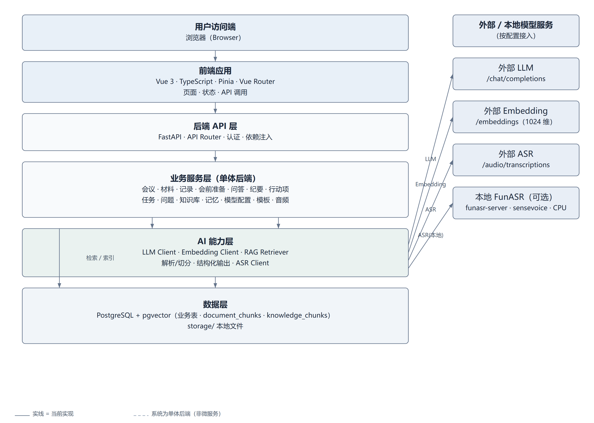
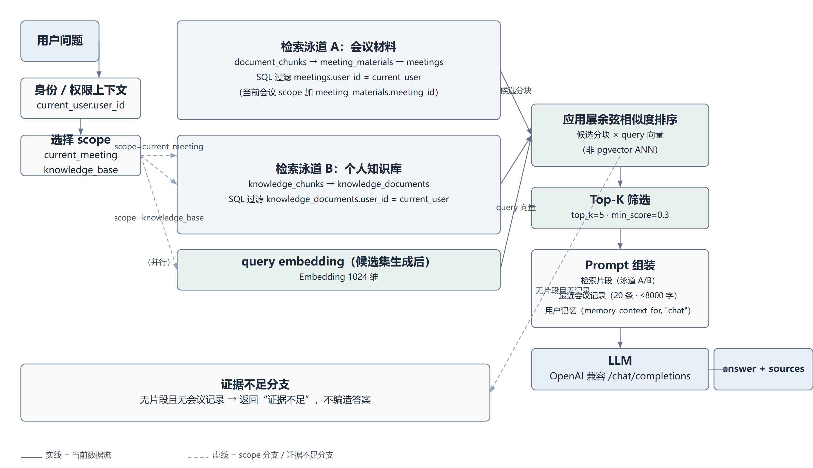
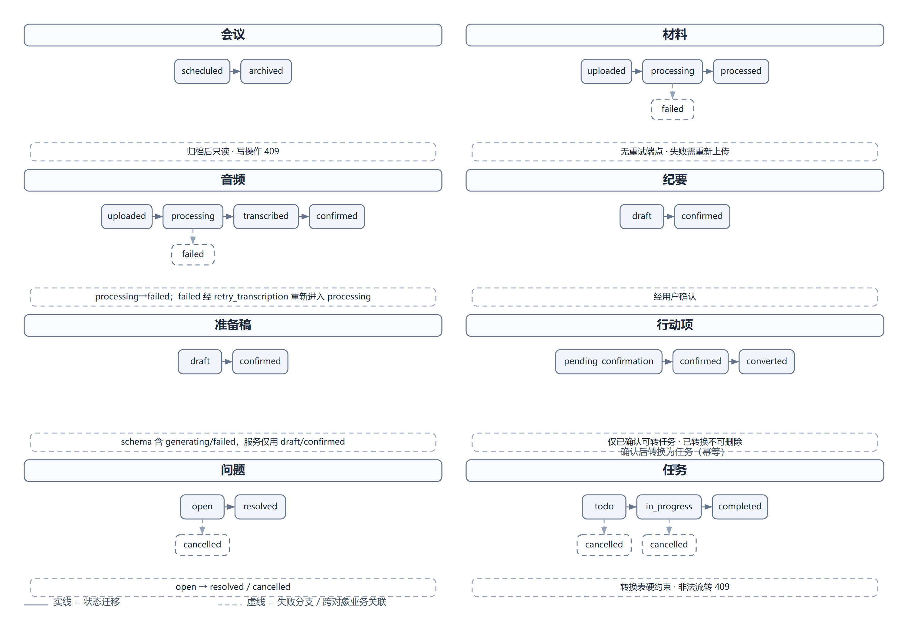
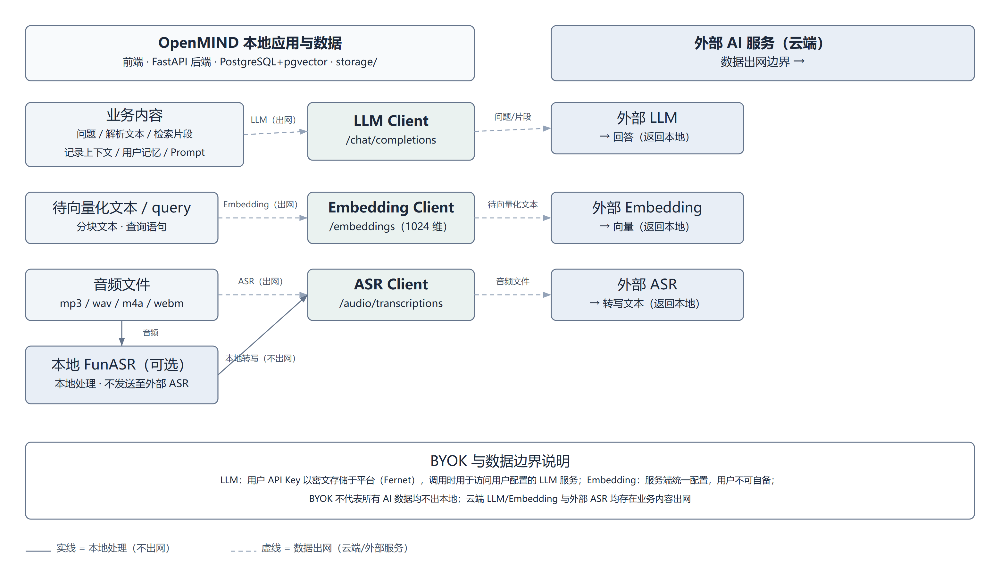
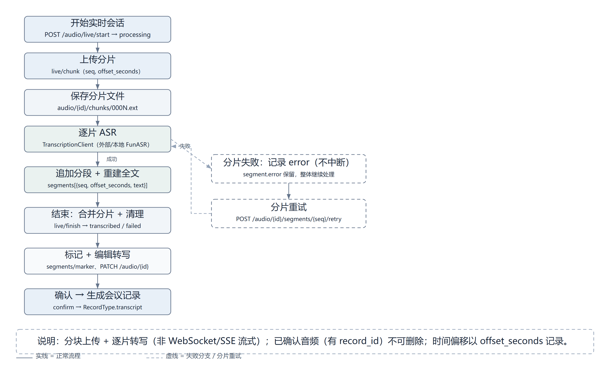
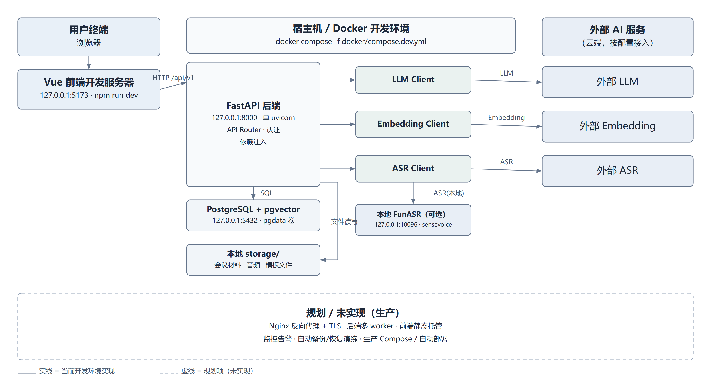

# OpenMIND（年轮）项目技术文档 5.0

> 版本：5.0　|　代码分支：main　|　Commit：ff42641
> 编制日期：2026-11-02　|　状态：评审稿
> Commit 全称：ff426413ef239e7f23133de206c402cab0b1d2a6

## 摘要

OpenMIND（年轮）是一个面向个人用户的 AI 会议助理，覆盖“创建会议 → 导入资料 → 会前准备 → 会中记录与实时转写 → 会议问答 → 生成纪要 → 确认行动项 → 个人任务跟进 → 未解决问题”的完整闭环，并扩展了会议模板、个人知识库、用户记忆、本地会议工作区和音频处理。系统采用前后端分离、单体后端架构：前端 Vue 3 + TypeScript + Vite，后端 FastAPI + SQLAlchemy，数据层 PostgreSQL 16 + pgvector，文件存于本地 `storage/`。AI 能力层统一封装 LLM、Embedding、RAG、解析与 ASR；LLM 支持用户自带密钥（BYOK，Fernet 密文存储、掩码回传、默认关闭全局回退），Embedding 由服务端统一配置；检索采用“SQL 权限下推 + 应用层余弦相似度”，不使用数据库原生 ANN；音频支持上传转写与“分片边录边转”（分块上传 + 逐片转写，非 WebSocket/SSE 流式）。

本文档以 `main` @ `ff42641`（`ff426413ef239e7f23133de206c402cab0b1d2a6`）为唯一基线，通过真实执行后端 350 项 pytest、前端 449 项 Vitest（连续 5 次全量通过）及 typecheck/lint/build 校验；在隔离测试栈中完成 PostgreSQL 16 + pgvector 真实集成、AI/Embedding/ASR Mock、音频、安全与 Playwright E2E 测试（8 spec / 8 case，连续 3 轮通过）；并完成真实 GLM-4-Flash 调用 2 次与 FunASR 转写→确认→生成会议记录流程验证。全文逐项区分“已实现 / 已测试（Mock）/ 真实环境已验证 / 未验证 / 规划中”，不虚构性能与评测结果；真实 Embedding 成功调用、外部 ASR、浏览器实时录音、本地目录真实写入、RAG 质量与压力测试仍未验收。

## 关键词

AI 会议助理；RAG 检索；BYOK；重试与降级；分片实时转写；状态机；多用户数据隔离；FastAPI；Vue 3；PostgreSQL/pgvector

## 1 项目概述

### 1.1 背景与定位

会议是知识型工作者的高频场景，但讨论内容易散落在录音、笔记与材料中，纪要与待办依赖人工整理。OpenMIND 定位为"个人会议助理"，用 AI 把会议输入（资料、录音、记录）组织为可用的结构化输出（纪要、行动项、任务、问题），并支持围绕会议材料的带来源问答。

### 1.2 目标用户与使用场景

目标用户为需要频繁开会的个人用户，系统以单用户数据隔离为边界。核心场景：会前上传资料并生成准备稿；会中记录要点、实时录音转写并就材料问答；会后生成纪要、提取候选行动项并转为个人任务；通过个人知识库与用户记忆辅助后续会议。

### 1.3 建设目标与范围

已实现范围：用户认证、会议管理、材料上传解析与索引、会前准备、会中记录与问答、纪要、行动项与任务、未解决问题、会议模板、个人知识库、用户记忆、模型配置（LLM BYOK）、音频上传/转写/实时分片、本地会议工作区。边界与限制见第 8 章。

表 1-1 技术栈（版本取自运行容器实际安装）

| 层 | 技术 | 版本 |
| --- | --- | --- |
| 前端 | Vue / Vite / TypeScript / Pinia / vue-router | 3.5.43 / 5.4.21 / 5.6.3 / 2.3.1 / 4.6.4 |
| 前端工具 | axios / Vitest / Playwright / Node | 1.20.0 / 2.1.9 / 1.64.1 / v22.23.2（容器内） |
| 后端 | FastAPI / SQLAlchemy / Pydantic / uvicorn | 0.150.0 / 2.1.5 / 2.14.1 / 0.54.0 |
| 后端工具 | httpx / Alembic / PyJWT / cryptography / Python | 0.28.1 / 1.20.0 / 2.15.1 / 50.0.2 / 3.13.16 |
| 数据 | PostgreSQL 16 + pgvector，Alembic 迁移 | — |
| AI | OpenAI 兼容（chat/completions、embeddings、audio/transcriptions、models） | — |

## 2 需求分析

### 2.1 用户需求与业务闭环

MVP 闭环 M00–M10：认证 → 会议 → 资料上传解析 → RAG 检索 → 会前准备 → 会中记录与问答 → 纪要与行动项 → 个人任务 → 未解决问题。在此基础上扩展会议模板、按用途模型路由、个人知识库、记忆中心、本地工作区与音频处理。

### 2.2 功能需求

表 2-1 功能模块与后端路由

| 模块 | 功能 | 后端路由模块 |
| --- | --- | --- |
| 认证 | 注册、登录、当前用户 | `auth` |
| 会议 | 创建/查询/归档 | `meetings` |
| 材料 | 上传、解析、索引、删除 | `materials` |
| 记录 | 会中记录 CRUD | `records` |
| 会前准备 | 生成/确认准备稿 | `preparations` |
| 问答 | 带来源问答、整理链 | `ai_chat` |
| 纪要 | 生成/确认、模板 | `minutes`、`templates` |
| 行动项 | 提取/确认/转任务 | `action_items` |
| 任务 | 状态流转、归档 | `tasks` |
| 问题 | 提取/解决/取消 | `issues` |
| 知识库 | 文档上传/索引/检索 | `knowledge` |
| 记忆 | 读写用户记忆 | `memory` |
| 模型配置 | LLM BYOK、用途模型、模型清单 | `settings` |
| 音频 | 上传/实时分片/转写/确认 | `audio` |
| 健康 | 健康检查 | `health` |

### 2.3 非功能需求

表 2-2 非功能需求

| 类别 | 要求 | 实现证据 |
| --- | --- | --- |
| 数据隔离 | 仅访问本人数据 | SQL 层按 `user_id` 过滤，越权 404 |
| 安全 | 密钥加密、URL 校验、密码哈希 | Fernet + SSRF 校验 + bcrypt |
| 可靠性 | 外部依赖故障可判别、可重试 | 错误码 + 重试（见 4.8） |
| 可测试性 | 依赖注入、协议抽象 | `httpx.BaseTransport`、`Retriever` Protocol |
| 可扩展 | 模型可替换、用途可路由 | LLM BYOK + ModelPurpose |

### 2.4 约束与非目标

约束：MVP 无 refresh token；后端单进程；前端开发服务器运行；端口仅绑定 127.0.0.1。非目标：多租户组织协作、WebSocket/SSE 流式转写、实时语音对话、移动端。

### 2.5 权限模型与隔离边界

系统以"单用户"为隔离边界：业务查询在 SQL 层按 `user_id` 过滤，越权统一返回 404（不区分"不存在"与"无权"）。资源归属链为 `users → meetings → {materials, records, audio, minutes, action_items, issues}`，知识库与记忆直接归属 `user_id`。归档会议只读；已确认音频、已转换行动项不可删除。系统不提供组织/团队/角色概念（非目标）。

## 3 系统架构设计

### 3.1 总体架构

系统为前后端分离的单体后端，AI 能力与业务分层隔离。



### 3.2 分层职责

表 3-1 分层职责

| 层 | 目录 | 职责 | 边界 |
| --- | --- | --- | --- |
| 前端 | `frontend/src/` | 展示、交互、调 API | 不直接访问数据库，不持有模型密钥 |
| 路由层 | `backend/app/api/` | HTTP 请求、依赖注入、响应 | 不含业务规则 |
| 服务层 | `backend/app/services/` | 业务规则、状态流转、权限 | 不直接写 HTTP |
| 仓储层 | `backend/app/repositories/` | 查询与持久化 | 不含业务规则 |
| AI 能力层 | `backend/app/ai/` | LLM/Embedding/RAG/解析/转写 | 不写会议 CRUD |
| 数据层 | PostgreSQL+pgvector + `storage/` | 持久化与文件 | — |

### 3.3 模块清单与统计口径

表 3-2 后端模块清单（统计口径）

| 类别 | 数量 | 说明 |
| --- | --- | --- |
| API Router 模块 | 16 | `api/v1/` 排除 `__init__.py`、`router.py`（含 health） |
| HTTP 路由装饰器 | 76 | GET 25 / POST 30 / PATCH 9 / PUT 3 / DELETE 9；另 `main.py` `GET /health` → 合计 77 |
| ORM 表 | 16 | `models/*.py` 的 `__tablename__` |
| 数据库迁移 | 22 | head `0022_audio_segments`，无 merge |
| services / repositories | 16 / 16 | 排除 `__init__.py` |

### 3.4 关键数据流：会议问答 RAG



流程：用户问题 → 按 scope 在 SQL 层过滤并取候选分块 → 生成 Query Embedding（1024 维）→ 应用层余弦相似度 → `top_k=5`、`min_score=0.3` 筛选 → 与会议记录、记忆组装 Prompt → LLM → 回答 + sources。两类来源过滤条件不同：会议材料经 `document_chunks → meeting_materials → meetings` 过滤 `meetings.user_id`（当前会议再加 `meeting_materials.meeting_id`）；个人知识库经 `knowledge_chunks → knowledge_documents` 过滤 `knowledge_documents.user_id`。会议记录不入向量索引，经 `_recent_record_context`（≤20 条 / 8000 字）作为直接上下文；用户记忆经 `memory_context_for(..., "chat")` 注入。无片段且无记录时返回"证据不足"。

### 3.5 核心业务状态机



表 3-3 核心业务状态（后端强制）

| 实体 | 状态流转 | 约束 |
| --- | --- | --- |
| 会议 | scheduled → archived | 归档后写操作 409 |
| 材料 | uploaded → processing → processed / failed | 无重试端点，失败需重新上传 |
| 音频 | uploaded → processing → transcribed / failed → confirmed | confirmed 需有转写文本；failed 经 retry 重新 processing |
| 纪要 / 准备稿 | draft → confirmed | 经用户确认；准备稿 schema 含未使用枚举 |
| 行动项 | pending_confirmation → confirmed → converted | 仅已确认可转任务；已转换不可删除 |
| 任务 | todo → in_progress → completed；todo/in_progress → cancelled | 转换表硬约束，非法流转 409 |
| 问题 | open → resolved / cancelled | 转换表约束 |

## 4 AI 技术方案

### 4.1 选型理由

AI 方案的取舍围绕"可替换、可测试、安全边界清晰、成本可控"：

表 4-1 AI 技术选型比较

| 能力 | 采用方案 | 选择理由与收益 | 代价、限制与替代 |
| --- | --- | --- | --- |
| LLM | OpenAI 兼容，统一 `LLMClient` | 事实标准、供应商可替换、客户端统一 | 依赖上游稳定性、同步非流式；替代：厂商 SDK、本地模型 |
| Embedding | OpenAI 兼容 `/embeddings`，服务端统一 | 维度一致、密钥集中、与 LLM 解耦 | 用户不可自备；依赖服务端配置 |
| RAG | SQL 权限下推 + 应用层余弦 | 越权数据不入应用层、纯 Python 可测 | 全表拉取、规模化代价高；替代：pgvector ANN（规划） |
| ASR | 外部兼容 + 本地 FunASR | 本地不出网 / 外部免算力 | 均非流式；实时为分片边录边转 |
| 结构化输出 | JSON + Pydantic | 格式错误可判别 | 不保证事实正确 |
| 模型配置 | LLM BYOK + 用途/请求级模型名覆盖 | 成本边界、按用途选型 | 密文入平台库；Embedding 不可自备 |

### 4.2 LLM 集成与模型配置

`LLMClient` 统一封装 `chat`/`chat_json`/`probe`/`list_models`；默认 temperature 0.2、单次超时 60s、最多 3 次尝试、退避 1s/3s。配置解析（`resolve_model_config`）：LLM 取用户配置（Fernet 解密），`ALLOW_GLOBAL_FALLBACK=true` 时未配置字段回退全局；用途模型（preparation/chat/minutes/extraction）与请求级 `model_override` **只覆盖模型名**，不改变 `api_base`/`api_key`；Embedding 始终取服务端 `settings.embedding_*`。保存前对 LLM 做 `probe()` 连通性校验，遇 429 视为密钥有效放行并返回 `llm_probe_verified=false`；服务商 `GET /models` 拉取模型清单供选择。

### 4.3 Embedding 与 RAG

Embedding 维度 1024、批量 ≤16、超时 30s、3 次尝试，维度不符即报错保证索引一致。RAG 采用"SQL 先过滤、应用层再算余弦"：先按 `user_id` 限定候选分块，再计算 query 与分块的余弦并排序，`top_k=5`、`min_score=0.3`。**不使用 pgvector `<=>`、HNSW/IVFFlat 或数据库原生 ANN**；大模型输出与检索均为同步调用。切分为 800 字、重叠 120 字（句子边界）。

### 4.4 BYOK 与密钥治理

LLM 密钥：Fernet 加密存库（密钥由 `SECRET_KEY` 经 SHA-256 派生）、支持 `SECRET_KEY_PREVIOUS` 轮换、仅回传掩码；`api_base` 保存时做 SSRF 校验（默认仅公网 HTTPS，`ALLOW_PRIVATE_MODEL_ENDPOINTS` 可放开）并实测探测。**Embedding 不支持用户自备**，由服务端 `docker/.env` 统一配置。默认 `ALLOW_GLOBAL_FALLBACK=false`，且该开关只作用于 LLM。需明确：密钥明文不入库，但**密文存储于平台数据库**，不能表述为"密钥完全不进入平台"。

### 4.5 Prompt 与结构化输出

Prompt 集中于 `ai/prompts/`：chat/prepare/minutes/extract_*，以及整理链 `organize`（support 任务：organize/summary/brief/polish）。`chat_json` 以 Pydantic 校验；整理链的 summary/polish 要求严格 JSON，`_parse_structured` 容错剥离代码块并截取首尾括号重试。结构化输出只约束格式，不保证事实正确，故采用"候选—确认"分离。

### 4.6 会议材料、知识库与记忆

会议材料解析后切分、向量化入 `document_chunks`；个人知识库入 `knowledge_chunks`；两者分别检索、`scope` 隔离（`current_meeting` / `knowledge_base`）。会议记录不入向量索引，作为直接上下文；用户记忆按用途注入（preparation 注入角色/场景/风格，chat 与 minutes 注入表达偏好）。

### 4.7 AI 与业务集成及数据边界



业务服务通过 `build_llm_client`/`build_embedding_client`/`TranscriptionClient` 调用 AI；云端 LLM/Embedding 与外部 ASR 会产生数据出网，本地 FunASR 路径不出网。BYOK 仅解决"用谁的密钥"，不改变数据出网范围。

### 4.8 重试、超时与降级

表 4-2 外部依赖错误码与重试策略

| 故障 | 错误码 | 行为 |
| --- | --- | --- |
| 超时 | `MODEL_TIMEOUT`(504) | 可重试，最多 3 次 |
| 限流 | `RATE_LIMITED`(429) | 可重试；保存探测遇 429 视为密钥有效放行 |
| 上游 5xx | `INTERNAL_ERROR`(500) | 可重试，受控 500 |
| 密钥无效 | `MODEL_CONFIG_INVALID`(400) | 不重试 |
| 额度不足 | `MODEL_QUOTA_EXCEEDED`(402) | 不重试 |
| 未配置 | `MODEL_CONFIG_REQUIRED`(400) | 网络调用前返回 |
| 输出非法 | `MODEL_OUTPUT_INVALID`(502) | 不重试 |

### 4.9 优化策略与验证状态

表 4-3 优化策略与验证状态

| 维度 | 当前实现 | 验证状态 |
| --- | --- | --- |
| Prompt | 用途模板 + 记忆/模板注入 | 设计策略，效果未量化 |
| 上下文 | top_k=5、min_score=0.3、chunk 800/overlap 120 | 未做相关性评测 |
| 检索 | user_id 下推、scope 隔离、余弦排序 | 越权用例已覆盖 |
| 输出可靠性 | JSON + Pydantic、非法输出错误、用户确认 | 格式错误路径已测 |
| 调用韧性 | 超时/重试/退避/错误分类；探测 429 容错 | 故障注入已测 |
| 成本与时延 | 无缓存/异步队列/限流/压测 | 未验证；无降本提速结论 |
| 评测闭环 | 无黄金评测集 | 规划中 |

## 5 核心功能实现

各功能注明业务流程、关键接口、服务层实现与数据模型，接口契约以 `docs/api.md` 为权威来源。状态标签：本文"已实现"仅指代码存在，"已测试"指 Mock/单元覆盖，真实环境验收见第 7 章。

### 5.1 会议管理与材料解析

- **业务流程**：创建/查询/归档会议；上传材料 → 解析 → 句子边界切分 → 向量化 → 进入检索库。
- **关键接口**：`POST/GET /meetings/{id}/materials`、`GET/DELETE /materials/{id}`、会议 CRUD 与归档。
- **服务层**：`meeting_service`（归属校验；归档后写 409）、`material_service`（uploaded→processing→processed/failed，解析失败置 failed 且**无重试端点**）、`indexing_service`（chunk 800 / overlap 120、Embedding 批量 ≤16）。
- **数据模型**：`meetings(status)`、`meeting_materials(processing_status, parse_error)`、`document_chunks(embedding)`。
- **边界**：仅 pdf/docx/txt、单文件 ≤20MB；失败需重新上传。

### 5.2 会前准备与会议问答

- **业务流程**：准备稿由材料 + 用户记忆生成，确认后生效；问答选择 scope（当前会议/知识库）→ 检索 + 记录 + 记忆 → LLM → 带 sources 回答；整理链支持 organize/summary/brief/polish。
- **关键接口**：`preparations` 生成/确认；`ai_chat` 问答/整理；`GET /me/settings/model/provider-models` 拉取模型清单。
- **服务层**：`preparation_service`（draft→confirmed）、`ai_chat_service`（`_resolve_organize_transcripts` 三级回退 text>audio>record>最近记录；`_parse_structured` 容错解析 JSON）。
- **数据模型**：`preparations`；检索分块与会议记录作为上下文（记录不入索引）。
- **边界**：无证据时拒答；summary/polish 为严格 JSON。

### 5.3 记录与纪要生成

- **业务流程**：记录 CRUD；按模板生成纪要 → 用户确认；模板内置 6 种或自定义（支持分类与仅文本模板）。
- **关键接口**：`records`、`minutes`、`templates`。
- **服务层**：`record_service`、`minutes_service`（draft→confirmed）、`meeting_template_service`（docx/txt/md，内容 ≤20000 字）。
- **数据模型**：`meeting_records`、`meeting_minutes(status)`、`meeting_templates(category)`。

### 5.4 行动项确认与任务管理

- **业务流程**：从记录提取候选行动项（pending_confirmation）→ 用户确认（confirmed）→ 转任务（converted）；任务按状态机流转；未解决问题 open→resolved/cancelled。
- **关键接口**：`action_items` 提取/确认/转任务；`tasks` 更新/取消/归档；`issues` 提取/更新。
- **服务层**：`action_item_service`（`action_id` 唯一，转任务幂等，已转换不可删）、`task_service`（`_ALLOWED_TRANSITIONS` 硬约束）、`issue_service`。
- **数据模型**：`action_items`、`personal_tasks(action_id unique)`、`open_issues`。
- **边界**：AI 仅产候选，不经确认不落地。

### 5.5 知识库、记忆与模型配置

- **业务流程**：个人知识库上传/解析/索引/语义检索（scope 隔离）；用户记忆手动维护并按用途注入；模型配置支持 LLM BYOK、用途模型、模型清单与删除。
- **关键接口**：`knowledge`、`memory`、`settings`（`GET/PUT/DELETE /me/settings/model`、`GET .../provider-models`、`PUT .../purposes`）。
- **服务层**：`knowledge_service`、`memory_service`（`memory_context_for` 按用途）、`model_config_service`（`resolve_model_config`、`probe`、`list_provider_models`）。
- **数据模型**：`knowledge_documents/knowledge_chunks`、`user_memories`、`user_model_configs`（仅 LLM 字段）。
- **边界**：Embedding 服务端统一、用户不可自备；记忆不自动提取。

### 5.6 音频处理与实时分片转写



- **整段上传转写**：上传 mp3/wav/m4a/webm（≤20MB）→ 同步转写（外部兼容 ASR 或本地 FunASR）→ transcript + 分段，状态 uploaded→processing→transcribed/failed；`retry` 可重试，已确认不可重试。
- **实时分片边录边转**：`live/start` 建 processing 会话 → `live/chunk` 上传分片（`seq` 连续、`offset_seconds` 相对时间）→ 逐片转写，成功追加 `segment` 并重建全文；单片失败仅记录 `error` 不中断，会话内 `segments/{seq}/retry` 重试 → `live/finish` 按序合并为主文件并清理临时分片，全文非空置 transcribed 否则 failed → `segments/marker` 标注重点/决议/疑问 → `PATCH /audio/{id}` 编辑转写（按行重拆分段）→ `confirm` 生成 `RecordType.transcript` 会议记录并置 confirmed（幂等）→ 已确认（有 `record_id`）不可删除。
- **关键接口/服务/模型**：`api/v1/audio.py`（12 端点）、`audio_service`、`meeting_audio(segments JSONB: seq/offset_seconds/text/marker_type/error)`；分片存 `audio/{id}/chunks/`，结束后合并清理。
- **边界**：**分块上传 + 逐片转写，不是 WebSocket/SSE 流式**；真实 ASR 与浏览器录音链路本次未验证。

### 5.7 本地会议工作区

前端使用 File System Access API（`showDirectoryPicker` + `requestPermission`），目录句柄存 IndexedDB，写入由前端发起、未授权静默跳过；受 Chromium 系浏览器限制，真实读写验收未执行。

## 6 项目创新点

创新点按"问题—机制—代码位置—价值—验证/局限"陈述，不以"使用某技术"本身作为创新。

### 6.1 技术创新点

1. **权限下推的双来源 RAG**：问题——越权分块可能进入应用层、临时材料污染长期知识；机制——SQL 先按 `user_id` 过滤再算余弦，材料/知识库分 scope；位置——`ai/rag/retriever.py`；价值——可测、可审计、隔离清晰；局限——全表拉取，规模化受限，未启用 ANN；验证——AI Mock 双来源问答与证据不足 22/22、PostgreSQL 用户隔离 13/13。
2. **LLM BYOK + 默认关闭全局回退 + 探测容错**：问题——团队垫付 Token、密钥风险；机制——Fernet 密文、掩码、`probe`（429 放行标记 `llm_probe_verified=false`）、SSRF 校验、`ALLOW_GLOBAL_FALLBACK=false` 且仅作用 LLM；位置——`model_config_service.py`、`crypto.py`、`url_validation.py`；价值——成本边界与合规；局限——密文入平台库。
3. **候选—确认—显式状态机**：问题——AI 误落地与脏数据；机制——AI 只产候选，确认后才转任务，后端状态机强制流转；位置——`action_item_service.py`、`task_service.py`；价值——防误落地；局限——仅覆盖已建模流转；验证——待办提取 E2E 与任务闭环 E2E（确认→转任务→状态更新→刷新持久化）通过。
4. **分片边录边转**：问题——长会议无法等待整段转写；机制——分块上传 + 逐片 ASR + 失败不中断 + 分段标记 + 结束合并；位置——`audio_service.py`；价值——边录边出文本、单片可重试；局限——非流式、真实 ASR 未验证；验证——音频 Mock 17/17。
5. **AI 客户端协议抽象 + Mock 测试**：问题——无模型/无库难测；机制——`httpx.BaseTransport` 注入 + `Retriever` Protocol；位置——`ai/chat/service.py`（`Retriever` Protocol）与 `tests/unit/test_*_client.py`（`httpx.MockTransport`）；价值——全链路可测；局限——不验证真实效果。
6. **模型探测的限流容错**：问题——保存时 429 会误判失败；机制——429 视为密钥有效放行并标记未完成调用验证；位置——`_probe_llm`；价值——限流不阻塞配置；局限——未完成真实调用验证。

### 6.2 应用创新点

1. **会前/会中/会后闭环**：问题——会议信息沉淀不足；机制——准备稿→记录/问答→纪要→行动项→任务；位置——各 service；价值——个人会议全流程可追溯；局限——单用户边界。
2. **材料与知识库分 scope**：问题——临时材料与长期知识混检；机制——`current_meeting` / `knowledge_base` 隔离；位置——`ai_chat_service.py`、`retriever.py`；价值——检索更聚焦。
3. **行动项确认后转任务（幂等）**：问题——AI 误提取与重复建任务；机制——候选→确认→转任务，`action_id` 唯一；位置——`action_item_service.py`；价值——减少重复任务。
4. **用户记忆按用途注入**：问题——输出风格与角色偏好不一致；机制——preparation 注入角色/场景/风格，chat/minutes 注入表达偏好；位置——`memory_service.py`；价值——输出更贴合用户；局限——手动维护，不自动提取。
5. **实时转写工作流**：问题——会中整理滞后；机制——边录边转 + 分片标记 + 编辑确认生成记录；位置——`audio_service.py` + `useLiveRecording.ts`；价值——现场即可产出可编辑文本；局限——非流式、真机未验收。
6. **本地会议工作区**：问题——文件需本地留存；机制——File System Access API 写本地目录；位置——`frontend/src/utils/localFileSystem.ts`；价值——数据可由用户自行落盘；局限——仅 Chromium、验收未完成。

表 6-1 创新点总表

| 分类 | 创新点 | 核心机制 | 状态 |
| --- | --- | --- | --- |
| 技术 | 双来源权限下推 RAG | SQL 过滤 + 应用层余弦 + scope | 已实现；AI Mock + PG 隔离通过 |
| 技术 | LLM BYOK + 默认关闭全局回退 | Fernet + 掩码 + probe + SSRF | 已实现；Mock 测试 |
| 技术 | 候选—确认—状态机 | 后端状态机硬约束 | 已实现；E2E 闭环通过 |
| 技术 | 分片边录边转 | 分块 + 逐片 ASR + 合并 | 已实现；音频 Mock 通过；真机未验收 |
| 技术 | 协议抽象 + Mock | Transport/Protocol | 已实现；测试使用 |
| 技术 | 探测限流容错 | 429 放行标记 | 已实现；未真实调用验证 |
| 应用 | 会前中后闭环 | 全流程 service | 已实现 |
| 应用 | 材料/知识库分 scope | scope 参数 | 已实现 |
| 应用 | 确认转任务幂等 | action_id 唯一 | 已实现；E2E 闭环通过 |
| 应用 | 记忆按用途注入 | memory_context_for | 已实现 |
| 应用 | 实时转写工作流 | 分片 + 标记 + 确认 | 已实现；真机未验收 |
| 应用 | 本地工作区 | File System Access | 已实现；验收未完成 |

## 7 测试与部署

### 7.1 测试环境与测试策略

代码基线为 `main` @ `ff42641`（`ff426413ef239e7f23133de206c402cab0b1d2a6`）。测试分四类环境：

1. 容器单元/接口测试：后端 Python 3.13.16，pytest 使用 SQLite 内存库并 monkeypatch Embedding；前端 Node v22.23.2 / Vitest 2.1.9。
2. 隔离测试栈：后端 8010、前端 5174、PostgreSQL 16.15 + pgvector 0.8.7、本地 OpenAI 兼容 Mock（LLM/Embedding/ASR）。
3. 真实服务验证：GLM-4-Flash 云模型调用、本地 FunASR 转写。
4. 浏览器端到端：Playwright 1.64.1 + Microsoft Edge。

测试策略覆盖单元测试、真实数据库集成、Mock HTTP 集成、真实供应商调用、Playwright E2E、安全与降级路径；Mock 测试与真实供应商测试分开统计，不相互替代。

### 7.2 自动化测试结果

表 7-1 自动化测试执行结果

| 类别 | 检查 | 结果 |
| --- | --- | --- |
| 单元/接口 | 后端 pytest | collected 350；350 passed；0 failed / 0 skipped / 0 errors；1 warning；98.94 s |
| 静态检查 | 后端 ruff | All checks passed |
| 单元/组件 | 前端 Vitest | 87 files / 449 passed；连续 5 次全量通过；0 failed / 0 skipped |
| 质量门禁 | typecheck / lint / build | 全部通过 |
| 真实数据库 | PostgreSQL 集成 | 13/13；ORM 16/16；重启持久性通过 |
| Mock HTTP | AI 全链路 | 22/22 |
| Mock HTTP | 音频全流程 | 17/17 |
| 安全 | 越权/密钥/上传/状态机 | 14/14 |
| 配置级 | SSRF | 6/6 |
| 配置级 | Fallback 默认关闭 | 4/4 |
| 浏览器 E2E | Playwright | 8 spec / 8 case；8 passed / 0 failed / 0 skipped；连续 3 轮（55.7 / 52.3 / 59.9 s） |

#### 7.2.1 自动化单元及组件测试

- 后端 pytest 350 项通过，覆盖认证、会议、材料、RAG、准备、记录、问答、纪要、行动项、任务、问题、模板、知识库、记忆、模型配置与音频。
- 前端 Vitest 87 个文件、449 项通过，连续 5 次全量运行均为 449/449。
- 路由单测将懒加载视图 stub 为轻量组件，保留真实 router/守卫/Pinia，断言仍检查重定向与放行；视图渲染由 E2E 覆盖，未发现空断言或跳过。

#### 7.2.2 前后端质量门禁

- 后端 `ruff check .` 通过；前端 `vue-tsc --noEmit`、`eslint .`、`vite build` 均通过。
- CI 配置在 push/PR 时执行上述检查，不包含部署。

#### 7.2.3 E2E 测试

E2E 共 8 个 spec / 8 个 case，覆盖：

| spec | 覆盖业务 |
| --- | --- |
| `core-flow` | 注册、建会、材料上传解析、记录新增与重点标记、知识库上传/检索、记忆保存、任务入口 |
| `ai-flow` | 会前准备生成、会议问答（带来源）、纪要生成、行动项提取、问题提取 |
| `audio-flow` | 音频上传、转写、编辑、确认生成会议记录 |
| `model-settings` | LLM BYOK 保存、密钥掩码、无 Embedding BYOK 入口、后端配置来源 |
| `local-workspace` | 浏览器不支持目录 API 时的降级提示（真实目录读写另行人工验收） |
| `auth-flow` | 注册后清除令牌、重新登录、刷新保持登录态 |
| `minutes-flow` | 纪要生成草稿、确认、刷新后持久化 |
| `task-closure` | 行动项确认→转任务→状态更新→刷新→后端任务接口复核 |

关键断言直接核对后端状态，而非仅检查按钮或提示：任务闭环在刷新后调用 `GET /tasks/{task_id}` 断言 `status=in_progress`；纪要闭环调用 `GET /meetings/{id}/minutes` 断言 `status=confirmed` 且内容持久化；音频确认后调用 `GET /meetings/{id}/records` 断言存在 `transcript` 记录；登录用例刷新页面验证令牌持久化。

E2E 连续 3 轮 8/8 通过，0 failed、0 skipped，未使用 `test.skip`、`test.fixme`、固定 sleep 或空断言。

#### 7.2.4 PostgreSQL 真实集成

在 PostgreSQL 16.15 + pgvector 0.8.7 的专用数据库上从空库迁移至 `0022_audio_segments`，验证 ORM 与迁移表列一致（16/16）、用户数据隔离、会议/材料/行动项/任务 CRUD、JSONB 音频分段读写与路径查询、外键、`action_id` 唯一约束、事务回滚与数据库重启后的持久性，共 13/13 通过。

#### 7.2.5 AI、音频、安全与降级（Mock）

- AI Mock 全链路 22/22：默认来源、BYOK 保存/掩码/明文不泄漏、正常与 429/500/401/402/非法 JSON、Embedding 维度错误、RAG 来源与 Top-K、无证据拒答、整理链、删除 BYOK 回退。
- 音频 Mock 17/17：上传、类型/大小校验、实时会话、分片、序号不连续、单片失败不中断与重试、分段标记、结束合并与清理、编辑、确认、幂等、删除限制与跨用户隔离。
- 安全 14/14、SSRF 6/6、Fallback 默认关闭 4/4；Mock 测试不等同于真实模型效果验证。

### 7.3 真实服务与端到端验证

- **真实 LLM**：使用 GLM-4-Flash 完成 2 次真实供应商调用，均成功；属于真实 API 调用，不是 Mock。
- **真实 FunASR**：完成音频转写 → 转写确认 → 生成会议记录全流程，属于本地 FunASR 实际转写，不是 Mock ASR。
- 真实服务验证用于确认外部依赖可用性；异常路径与边界仍由 Mock 测试覆盖，两者分开陈述。

### 7.4 测试边界与未验收事项

| 项目 | 状态 | 说明 |
| --- | --- | --- |
| 真实 Embedding 成功调用 | 未成功验证 | 调用出网但返回限流，未取得成功样本 |
| 外部 ASR 真实供应商 | 未完成验证 | 无外部 ASR 凭据 |
| 浏览器麦克风实时录音 | 未验收 | 需人工授权麦克风并录制 |
| 本地工作区真实目录读写 | 未验收 | 需人工选择目录并授权写入 |
| RAG 检索质量 | 未评测 | 无标注评测集，不报告准确率/召回率 |
| 压力测试 | 未执行 | 无并发/QPS 数据 |
| 生产部署 | 未验收 | Docker Compose 仅用于开发环境 |
| 真实服务原始日志 | 未归档 | GLM-4-Flash 与 FunASR 调用记录未保留原始日志，复测需凭据/模型 |

另：Mock 测试不等于真实模型测试；不得据此宣称模型效果或识别准确率。

### 7.5 部署说明

开发环境使用 `docker compose -f docker/compose.dev.yml` 启动 db/backend/frontend（可选 `--profile asr`），端口均绑定 127.0.0.1：



| 服务 | 端口 | 说明 |
| --- | --- | --- |
| db | 5432 | PostgreSQL 16 + pgvector，数据卷持久化 |
| backend | 8000 | FastAPI 单进程 uvicorn |
| frontend | 5173 | Vite 开发服务器 |
| asr | 10096 | 本地 FunASR（可选） |

关键环境变量：

- 数据库：`DATABASE_URL`。
- 安全：`SECRET_KEY`（JWT 与 Fernet 密钥派生）、`SECRET_KEY_PREVIOUS`（轮换兼容）。
- 模型服务：`LLM_API_BASE/KEY/MODEL`、`EMBEDDING_API_BASE/KEY/MODEL/DIM`、`ASR_API_BASE/KEY/MODEL`。
- 开关：`ALLOW_GLOBAL_FALLBACK`（默认 false）、`ALLOW_PRIVATE_MODEL_ENDPOINTS`（默认 false）。
- 存储：`STORAGE_DIR`（默认 `./storage`）。

生产所需 Nginx/TLS、多 worker、前端静态托管、监控告警、备份恢复与自动部署均未实现，不能将开发编排视为生产验收方案。

### 7.6 CI

`.github/workflows/ci.yml` 仅在后端执行 ruff + pytest、前端执行 typecheck/lint/test/build，不含部署。

### 7.7 质量门禁与复现

后端门禁：`ruff check .` + `pytest`；前端门禁：`typecheck` + `lint` + `test` + `build`。复现命令与原始日志见 `docs/techdoc-5.0/04-test-evidence.md`、`05-system-test-report.md`、`06-e2e-test-report.md`、`docs/test-review/test-execution-report.md` 与 `test-logs/`。

## 8 总结与展望

### 8.1 完成情况

表 8-1 成果指标（当前基线）

| 指标 | 数值 |
| --- | --- |
| 后端 Router / HTTP 路由 | 16 / 77 |
| ORM 表 / 迁移 | 16 / 22（head 0022） |
| 后端测试 | 350 项通过 |
| 前端测试 | 449 项，连续 5 次全量通过 |
| 前端质量门禁 | typecheck/lint/build 通过 |
| 真实 PostgreSQL 集成 | 13/13，ORM 16/16，重启持久性通过 |
| AI / 音频 / 安全 / SSRF / Fallback | 22/22、17/17、14/14、6/6、4/4 |
| 浏览器 E2E | 8 spec / 8 case，连续 3 轮通过 |
| 真实服务 | GLM-4-Flash 2 次调用成功；FunASR 转写→确认→生成记录成功 |
| 核心闭环 | M00–M10 及模板、知识库、记忆、工作区、音频 |

### 8.2 当前限制

RAG 质量与性能未评测；无压测；单进程、同步 AI 调用、无限流/缓存/异步队列；生产部署/监控/备份为规划；实时转写为分片非流式且真机未验收；本地工作区未验收；安全残余风险（DNS 重绑定、上传嗅探、限流、密钥独立管理）未实现。

### 8.3 未来规划

表 8-2 下一阶段路线

| 阶段 | 目标 |
| --- | --- |
| 短期 | 生产化部署（TLS/Nginx/多 worker/静态托管）、监控备份、应用层限流、异步任务、HNSW 索引 |
| 中期 | RAG 评测集与质量迭代、流式输出、检索重排序、扫描件 OCR |
| 长期 | 本地大模型替代、私有化一体机、企业知识库与多租户 |

## 参考资料

1. 项目代码与配置：`backend/`、`frontend/`、`docker/`、`.github/`（基线 `ff42641`，访问日期 2026-11-02）。
2. 项目设计文档：`docs/design-baseline.md`、`api.md`、`database.md`、`ai-design.md`、`architecture.md`、`requirements.md`、`testing.md`。
3. 测试与验收：`docs/test-reports/`（历史基线）、`docs/techdoc-5.0/test-logs/vitest-2026-11-02.log`。
4. GB/T 7713.3—2014《科技报告编写规则》（国家标准全文公开系统，https://std.samr.gov.cn/gb/search/gbDetailed?id=BqRKTfwYTvw%3D&mode=p ，访问日期 2026-11-02）。

## 附录 A 统计口径

- API Router：`backend/app/api/v1/` 排除 `__init__.py`、`router.py`，共 16 个（含 health）。
- HTTP 路由：各模块 `@router.*` 76 个（GET 25 / POST 30 / PUT 3 / PATCH 9 / DELETE 9）+ `main.py` 的 `/health` 1 个 = 77。
- ORM 表：`backend/app/models/*.py` 的 `__tablename__` = 16。
- 迁移：`backend/alembic/versions/` 22 个，head `0022_audio_segments`。
- Services / Repositories：各 16 个（排除 `__init__.py`）。
- 内置会议模板：`meeting_template_service.BUILTIN_TEMPLATES` = 6。
- 音频接口：`backend/app/api/v1/audio.py` = 12。
- 前端 Views：`frontend/src/views/**/*.vue` = 12。
- 后端测试：`pytest` = 350；前端：`vitest run` = 449（87 files）；E2E：8 spec / 8 case。

## 附录 B 数据库表清单

表 B-1 数据库表清单

| 表 | 说明 |
| --- | --- |
| users | 用户 |
| meetings | 会议（scheduled/archived） |
| meeting_materials | 会议材料 |
| document_chunks | 材料向量分块 |
| meeting_records | 会议记录 |
| preparations | 会前准备稿 |
| meeting_minutes | 会议纪要 |
| action_items | 候选行动项 |
| personal_tasks | 个人任务 |
| open_issues | 未解决问题 |
| meeting_audio | 会议音频（含 segments） |
| meeting_templates | 会议模板（含 category） |
| user_model_configs | LLM 模型配置（BYOK，密文） |
| knowledge_documents | 知识库文档 |
| knowledge_chunks | 知识库向量分块 |
| user_memories | 用户记忆 |

## 附录 C API 统计

表 C-1 API 模块与端点

| 模块 | 主要端点 |
| --- | --- |
| 认证/会议/材料/记录 | 注册登录、会议 CRUD+归档、材料上传/列表/详情/删除、记录 CRUD |
| 准备/问答/纪要/行动项 | 准备稿生成/确认、问答/整理/整理链、纪要生成/确认、行动项提取/确认/转任务 |
| 任务/问题/知识库/记忆 | 任务流转/归档、问题提取/更新、知识库上传/检索、记忆读写 |
| 模型配置 | `GET/PUT/DELETE /me/settings/model`、`GET /me/settings/model/provider-models`、`PUT /me/settings/model/purposes` |
| 音频（12） | 上传/列表/详情、`live/start`、`live/chunk`、`live/finish`、`segments/{seq}/retry`、`segments/marker`、`PATCH /audio/{id}`、`retry`、`confirm`、`delete` |

## 附录 D 测试执行记录

**测试环境**：后端 Python 3.13.16 / FastAPI 0.150.0；前端 Node v22.23.2 / Vitest 2.1.9；PostgreSQL 16.15 + pgvector 0.8.7；Playwright 1.64.1 + Edge；测试栈使用隔离数据库 `openmind-db-test` 与本地 Mock AI/ASR。

**测试命令**

```bash
# 后端
docker exec openmind-backend-1 ruff check .
docker exec openmind-backend-1 python -m pytest

# 前端
docker exec openmind-frontend-1 npm run typecheck
docker exec openmind-frontend-1 npm run lint
docker exec openmind-frontend-1 npm run test
docker exec openmind-frontend-1 npm run build

# PostgreSQL / AI / 音频 / 安全
docker exec -e PYTHONPATH=/app openmind-test-backend-test-1 python /tests/scripts/pg_integration.py
docker exec -e PYTHONPATH=/app openmind-test-backend-test-1 python /tests/scripts/ai_mock_checks.py
docker exec -e PYTHONPATH=/app openmind-test-backend-test-1 python /tests/scripts/audio_mock_checks.py
docker exec -e PYTHONPATH=/app openmind-test-backend-test-1 python /tests/scripts/security_checks.py

# E2E
cd frontend
E2E_BASE_URL=http://localhost:5174 E2E_API_BASE=http://localhost:8010/api/v1 \
E2E_CHANNEL=msedge E2E_EXPECT_ASR=1 npx playwright test --reporter=line
```

**测试结果**：pytest 350 passed（0 failed / 0 skipped / 0 errors，1 warning，98.94 s）；ruff 通过；Vitest 87 files / 449 passed，连续 5 次；typecheck/lint/build 通过；PostgreSQL 集成 13/13（ORM 16/16，重启持久性通过）；AI Mock 22/22；音频 Mock 17/17；安全 14/14；SSRF 6/6；Fallback 4/4；E2E 8/8，连续 3 轮（55.7 / 52.3 / 59.9 s），0 failed / 0 skipped。

**真实服务**：GLM-4-Flash 2 次调用成功；FunASR 转写→确认→生成会议记录流程成功。真实调用不等同于 Mock 测试，异常路径仍以 Mock 覆盖。

**日志位置**：`docs/techdoc-5.0/test-logs/`、`docs/test-review/logs/`（含 pytest、ruff、Vitest×5、build、PG、AI、音频、安全、SSRF、Fallback、E2E 各轮原始日志）。

**未验证事项**：真实 Embedding 成功调用、外部 ASR、浏览器实时录音、本地工作区真实读写、RAG 质量评测、压力测试、生产部署验收。

## 附录 E 术语

表 E-1 术语表

| 术语 | 说明 |
| --- | --- |
| LLM / Embedding / RAG / ASR | 大模型 / 向量化 / 检索增强生成 / 语音转写 |
| BYOK | 用户自带模型密钥（本系统仅 LLM） |
| 分片边录边转 | 分块上传 + 逐片转写（非流式） |
| 候选行动项 | AI 提取、待确认的行动项 |
| scope | 检索范围：current_meeting / knowledge_base |

## 附录 F 版本演进

表 F-1 版本演进

| 版本 | 基线 | 主要变化 |
| --- | --- | --- |
| 4.1 | 7454a20 | 8 章结构；BYOK（含用户 Embedding）；批量音频转写 |
| 5.0 | ff42641 | Embedding 收归服务端；音频分片边录边转；多任务整理链；模板分类；模型探测/清单；7 部分+创新点结构 |
